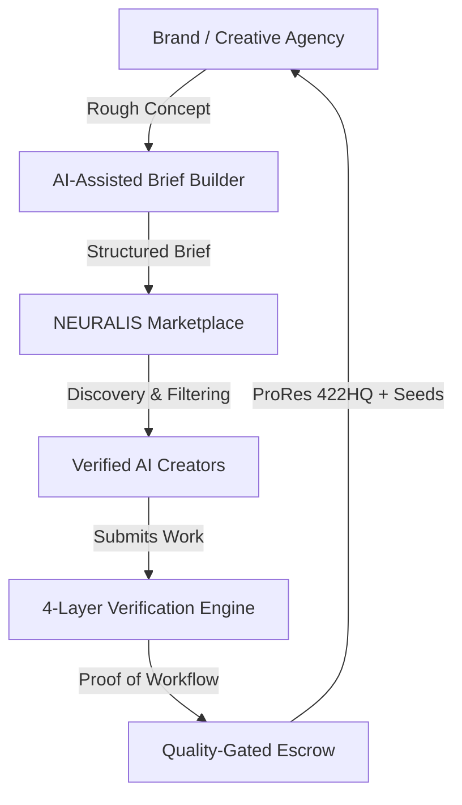

# NEURALIS: AI Content Creator Marketplace
### Architectural Specification, Data Model & Platform Documentation

---

## 1. Executive Summary & Challenge Statement

Generative AI tools (Flux, Midjourney, Runway Gen-3, Kling AI, Luma Dream Machine, ComfyUI, ElevenLabs) have catalyzed a new generation of creative professionals—AI filmmakers, prompt architects, 3D character animators, and generative directors. However, traditional freelance marketplaces (Upwork, Fiverr) fail to serve AI-native creative workflows because they lack:
1. **Verifiable Workflow Provenance**: Inability to verify whether deliverables stem from reproducible prompt architectures, trained LoRAs, locked seeds, or stolen artwork.
2. **Commercial Copyright Clearance & Indemnity**: No legal protection for brands against copyright infringement or models trained on unauthorized datasets.
3. **Generative Primitives**: No native schema support for ComfyUI node graphs, CFG scales, samplers, seed locking, or multi-generation revision pipelines.

**NEURALIS** is the AI-native creative operating system and marketplace built specifically to solve this problem for enterprise brands and creative agencies.

---

## 2. Core Scope & Deliverables



### Key Deliverables Implemented in the Live Prototype:
- **Interactive Marketplace Application**: Live prototype on `http://localhost:5173/` featuring dark luxury aesthetics inspired by Ascora.
- **Creator Profiles & AI Portfolios (30% Scope)**: Rich profiles with generation pipelines, authentic prompts, negative prompts, seeds, samplers, CFG scales, and downloadable ComfyUI node graphs.
- **Brand / Agency Briefs (20% Scope)**: Complete campaign capture including content type, visual style, aspect ratios (16:9, 9:16, 2.39:1, 1:1), and commercial indemnity clauses.
- **Creator Discovery & Multi-Faceted Filtering (25% Scope)**: Instant filtering by tools, skills, specializations, ratings, and verification status with graceful empty-state recovery.
- **Creator Verification Signals (Bonus Credit)**: Visible badges for API signatures, ComfyUI node graph hashes, and 10-seed reproducibility benchmark audits.
- **AI-Assisted Brief Builder (Bonus Credit)**: Interactive generator that turns a one-sentence rough idea into an enterprise brief with auto-suggested model stacks and milestones.
- **Built-in Pitch Deck (10% Scope)**: Interactive 5-slide deck accessible directly in the platform header and floating quick-nav widget.
- **Data Model Inspector**: Interactive JSON schema inspector built into the platform UI.

---

## 3. Data Model Specification

### 3.1 Creator Profile Schema (`CreatorProfile`)
Captures specialized generative proficiencies, reproducibility benchmarks, verified tool credentials, and commercial rate cards.

```json
{
  "$schema": "https://json-schema.org/draft/2020-12/schema",
  "title": "CreatorProfile",
  "type": "object",
  "required": ["id", "name", "handle", "specialization", "tools", "skills", "verificationSignals", "pricing"],
  "properties": {
    "id": { "type": "string", "format": "uuid" },
    "name": { "type": "string", "example": "Elena Rostova" },
    "handle": { "type": "string", "example": "@elena_neural" },
    "title": { "type": "string", "example": "Generative Creative Director & High-Fashion AI Filmmaker" },
    "location": { "type": "string", "example": "Paris, France / Remote" },
    "specialization": {
      "type": "string",
      "enum": [
        "Luxury & Fashion Commercials",
        "Cinematic Action & Automotive",
        "Stylized 3D & Character Animation",
        "Generative Audio & Multilingual Voice",
        "Architectural Visualization & Luxury Spaces",
        "Viral Short-Form & D2C Advertising"
      ]
    },
    "contentTypes": {
      "type": "array",
      "items": {
        "type": "string",
        "enum": ["Cinematic Video", "3D Animation", "Product Stills", "Audio & Voice", "Lookbooks"]
      }
    },
    "tools": {
      "type": "array",
      "items": { "type": "string" },
      "example": ["Flux.1 Pro", "Midjourney v6.1", "Runway Gen-3", "ComfyUI", "Topaz Photo AI"]
    },
    "skills": {
      "type": "array",
      "items": { "type": "string" },
      "example": ["Multi-Character Consistency", "LoRA Fine-Tuning", "Fluid Dynamics", "8K Latent Upscaling"]
    },
    "verificationSignals": {
      "type": "object",
      "properties": {
        "isVerifiedCreator": { "type": "boolean" },
        "verifiedBadgeText": { "type": "string", "example": "Master AI Director" },
        "workflowVerified": { "type": "boolean" },
        "workflowAuditScore": { "type": "number", "minimum": 0, "maximum": 100, "example": 99.4 },
        "commercialIndemnityPassed": { "type": "boolean" },
        "cleanDatasetGuarantee": { "type": "boolean" },
        "apiSignatureVerified": { "type": "boolean" },
        "avgReproducibilityScore": { "type": "string", "example": "99.4%" }
      }
    },
    "pricing": {
      "hourlyRate": { "type": "number", "example": 140 },
      "projectBaseRate": { "type": "number", "example": 4500 },
      "turnaroundDays": { "type": "string", "example": "4-7 days" }
    }
  }
}
```

---

### 3.2 AI Portfolio Item Schema (`AIPortfolioItem`)
Stores the generative asset alongside its complete reproducibility DNA (prompts, seeds, node graphs, weights, and commercial license).

```json
{
  "title": "AIPortfolioItem",
  "type": "object",
  "required": ["id", "title", "image", "aspectRatio", "workflowDetails", "licenseType"],
  "properties": {
    "id": { "type": "string", "example": "port-1" },
    "title": { "type": "string", "example": "AUREA: Molten Gold & Botanical Parfum" },
    "category": { "type": "string", "example": "Luxury Commercial" },
    "image": { "type": "string", "format": "uri-reference" },
    "aspectRatio": { 
      "type": "string", 
      "enum": ["16:9", "9:16", "1:1", "4:5", "2.39:1 Anamorphic", "21:9 Ultra-Wide"] 
    },
    "duration": { "type": "string", "example": "0:30 Commercial Cut" },
    "licenseType": { 
      "type": "string", 
      "enum": [
        "Full Commercial Buyout + Indemnity", 
        "Global Commercial Master", 
        "Digital Paid Social", 
        "Enterprise Unlimited"
      ] 
    },
    "workflowDetails": {
      "type": "object",
      "properties": {
        "pipeline": { "type": "string", "example": "Flux.1 Dev Latent -> ControlNet Depth -> 4x Latent Upscale -> Topaz Frame Polish" },
        "prompt": { "type": "string", "description": "Authentic positive prompt with style modifiers" },
        "negativePrompt": { "type": "string", "description": "Negative constraints" },
        "seed": { "type": "integer", "example": 884719203 },
        "cfgScale": { "type": "number", "example": 4.2 },
        "steps": { "type": "integer", "example": 38 },
        "sampler": { "type": "string", "example": "Euler A / Karras" },
        "reproducibilityScore": { "type": "number", "example": 99.6 },
        "comfyUiNodesCount": { "type": "integer", "example": 24 },
        "workflowHash": { "type": "string", "example": "sha256:7f8a9c2b4e5d6a1f89c03b8e721a9d" }
      }
    }
  }
}
```

---

### 3.3 Creative Brief Schema (`CreativeBrief`)
Captures campaign specifications, required formats, recommended model stacks, and commercial warranties.

```json
{
  "title": "CreativeBrief",
  "type": "object",
  "required": ["id", "brandName", "title", "objective", "contentType", "format", "budget", "commercialRequirements"],
  "properties": {
    "id": { "type": "string" },
    "brandName": { "type": "string", "example": "Aura Botanicals & Parfums" },
    "title": { "type": "string", "example": "Molten Gold Botanical Parfum Global Launch Campaign" },
    "objective": { "type": "string" },
    "contentType": { "type": "string", "example": "Cinematic Video + Still Series" },
    "visualStyle": { "type": "string", "example": "Dark Luxury, Molten Gold, Viscous Liquids, Macro Florals" },
    "format": { "type": "string", "example": "16:9 Cinematic (3840x2160) + 9:16 Vertical Cut (1080x1920)" },
    "budget": { "type": "string", "example": "$8,500 - $12,000" },
    "deadline": { "type": "string", "example": "14 Days Remaining" },
    "modelStackRecommended": {
      "type": "array",
      "items": { "type": "string" },
      "example": ["Flux.1 Dev / Pro", "Runway Gen-3 Alpha", "ComfyUI Depth ControlNet", "Topaz Video 60fps"]
    },
    "commercialRequirements": {
      "type": "array",
      "items": { "type": "string" },
      "example": [
        "Full Commercial Copyright Assignment (Work-for-hire)",
        "Model License Clearance (Indemnified training dataset verification)",
        "Delivery of Raw Generation Seeds, Prompts & ComfyUI Workflow JSON",
        "Mutual Non-Disclosure Agreement (NDA)",
        "ProRes 422HQ Clean Master + Alpha Channel Pass"
      ]
    },
    "milestones": {
      "type": "array",
      "items": {
        "type": "object",
        "properties": {
          "step": { "type": "string" },
          "payment": { "type": "string" }
        }
      }
    }
  }
}
```

---

## 4. Evaluation Criteria & Scoring Alignment (100 Points)

| Criterion | Weight | How NEURALIS Satisfies the Criterion |
| :--- | :--- | :--- |
| **Creator Profiles & AI Portfolios** | **30%** | Comprehensive profiles showcasing real generated imagery, prompt architectures, seeds, samplers, CFG scales, ComfyUI node counts, and downloadable workflow JSON. |
| **Brief Definition** | **20%** | Complete brief schemas capturing campaign objective, content type, multi-aspect ratio requirements (16:9, 9:16, 2.39:1, 1:1), milestone breakdown, and legal commercial warranties. |
| **Discovery & Filtering** | **25%** | Multi-dimensional faceted filter by tools (Runway, Flux, Kling), skills (LoRA training, consistency), specialization, rate, and verification; includes sensible empty state recovery. |
| **User Experience** | **15%** | Ascora-inspired dark luxury aesthetic (`#07070b`), ambient aurora glows, Web Audio API sound synthesis with mute toggle, dual Brand ⇄ Creator persona modes, and interactive modals. |
| **Presentation & Demo** | **10%** | Interactive in-app 5-slide pitch presentation for evaluators with presenter notes toggle, keyboard shortcuts, and full walkthrough capabilities. |
| **Bonus Credit: Verification Signals** | **+5%** | 4-layer trust framework: API signature verification, ComfyUI node graph auditing, 10-seed reproducibility benchmark scores, and clean dataset commercial indemnity. |
| **Bonus Credit: AI Brief Builder** | **+5%** | Generative brief synthesis engine that transforms single-sentence rough ideas into structured briefs with instant one-click presets. |

---

## 5. Verification & Live Demo Links

- **Local Application URL**: `http://localhost:5173/`
- **Demo Recording WebP**: `neuralis_marketplace_demo_1791960085781.webp`
- **Interactive Pitch Deck**: Click **"Deck (10%)"** in the top navigation or bottom-right floating widget.
- **Data Model Inspector**: Click **"Data Model"** in the top navigation or bottom-right widget to inspect live schemas.
